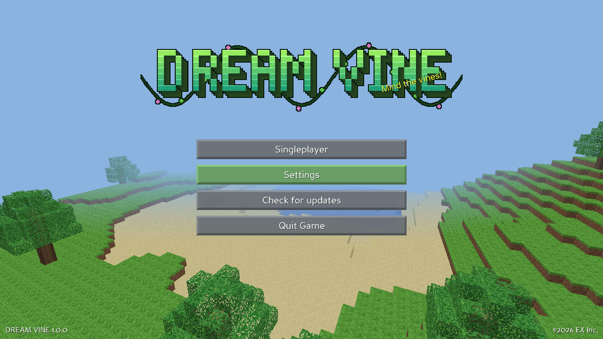
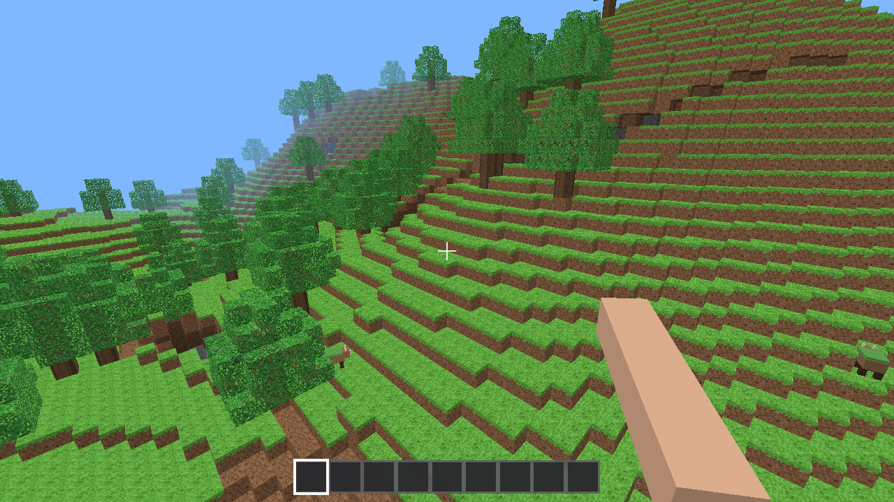

# DREAM VINE

An original block-building sandbox game for Windows by **EX Inc.** Explore endless procedurally generated worlds, mine, craft, build, survive the night or fly around in Creative.

All code, textures, names, mobs and logos are **original**. Everything is generated procedurally, and no third-party game assets are used.




## Download
Get **DREAM.VINE.Setup.x.y.z.exe** from the [latest release](https://github.com/Teobokki/dream-vine/releases/latest). This is recommended: it installs per-user with no admin rights and adds Start-menu and optional desktop shortcuts. A portable zip and a single-file **DREAM.VINE.Portable.exe** (no install, runs from any folder) are also attached.
Use **Check for updates** on the title screen to install new versions. The installed copy downloads and runs the new Setup; the portable exe (1.2.0+) downloads the new `DREAM.VINE.Portable.exe`, closes, replaces itself in place (same file name and folder) and restarts.

## Features
- Infinite chunked worlds from a seed: grass, dirt, stone, sand beaches, water, gravel, hills and mountains, forests, caves, coal/iron/gold/diamond ores and bedrock
- Survival (health, hunger, fall damage, hold-to-break with crack animation, tool tiers) and Creative (all blocks, instant break, double-tap Space to fly)
- 9-slot hotbar plus a 27-slot inventory, and crafting: planks, sticks, Crafting Table, wooden/stone/iron/diamond pickaxe, axe, shovel and sword, glass, bricks, mossy stone, Dream Vine blocks
- Day/night cycle with sky colours, sunset, sun, moon, clouds and fog
- Mobs: **Mossbuck** (passive grazer, drops meat) and **Gloomer** (hostile at night, glowing eyes, drops coal)
- **Text chat** (Survival and Creative): press **T** or **Enter**, type, Enter to send, Esc to close. Commands: `/help`, `/gamemode survival|creative`, `/time day|night|noon|<number>`, `/tp x y z`, `/seed`, `/clear`, `/build <description>`, `/undo`, `/name <name>`
- **VINE BUILD** (Creative): press **B** (or the button in the inventory), describe any building and **Vine AI** builds it in front of you - fully offline. Japanese temples/pagodas/castles, torii, Chinese pagoda, medieval/fairy-tale castles, houses, cottages, cabins, modern houses, mansions, skyscrapers, lighthouses, windmills, pyramids, Greek temples, churches, cathedrals, barns, farms, igloos, treehouses, bridges, walls, towers, fountains, obelisks, statues, stadiums, shops, tents, observatories, ships, greenhouses, plus (1.3.1) palaces, mosques, sphinxes, mushroom houses, hobbit holes, rockets, UFOs, volcanoes, giant trees, huts, gazebos, arches, Eiffel-style towers, Stonehenge, creature statues and styles (cyberpunk/neon, underwater, haunted, ice, candy, Egyptian, Arabian, Russian, Viking, elven, steampunk, tropical, lava, royal, space, rainbow, ruined, floating). It tolerates typos, and for anything it doesn't recognise it invents a building from your words (shape, roof, towers, windows). Understands sizes, materials, colours and extras (garden, moat, pond, cherry trees, lanterns, chimney...). **Ctrl+Z** or `/undo` undoes the last build.
- Autosave to `%APPDATA%\DREAM VINE\saves`, settings (render distance, mouse sensitivity, FOV, fullscreen)

## Controls
| Key | Action |
|---|---|
| WASD / Mouse | Move / look |
| Space | Jump (double-tap in Creative = fly; Space/Shift = up/down) |
| Shift | Sneak (won't walk off edges) |
| Ctrl or double-tap W | Sprint |
| Left click | Break block (hold in Survival) / attack |
| Right click | Place block / eat food / open Crafting Table |
| 1-9 / mouse wheel | Select hotbar slot |
| E | Inventory and crafting |
| Esc | Game menu (Back to Game, Settings, Save & Quit to Title) |
| F2 | Screenshot to Downloads |
| F3 | Debug info (FPS, XYZ, chunk, facing...) |
| F1 | Hide HUD |
| F9 | Start / stop **EX CREATOR SCREEN RECORDER 2026** (also in the Esc menu); MP4 saved to Downloads |

## Building from source
Python 3.11 with `panda3d==1.10.16 numpy==1.26.4 pyinstaller`, then:
```
python make_assets.py          # needs Pillow; icon.ico/icon.png from assets/icon_source.jpg, plus logo.png
pyinstaller --noconfirm --clean "DREAM VINE.spec"
ISCC installer.iss              # Inno Setup 6
```

©2026 EX Inc./HYPERION DIGITAL ©2026
